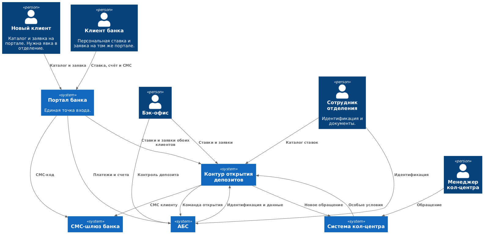
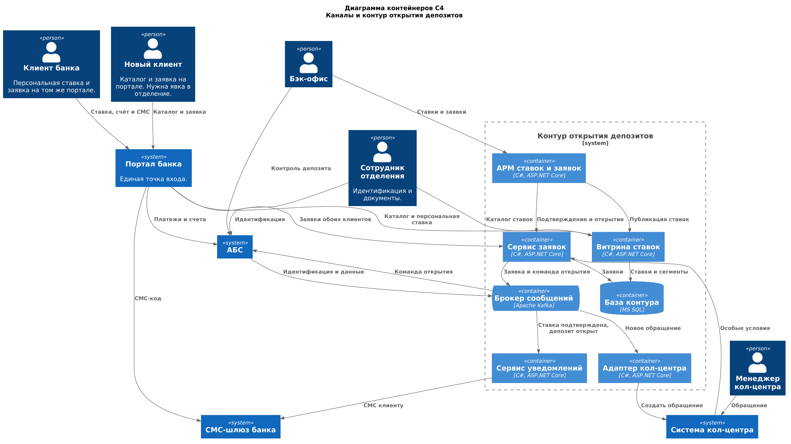

### **Название задачи:** Архитектура открытия депозитов
### **Автор:**Лушников А.М.
### **Дата:**13.10.2026

### **Функциональные требования**
|**№**|**Действующие лица или системы**|**Use Case**|**Описание**|
| :-: | :- | :- | :- |
| UC1 | Новый клиент, сайт, витрина ставок | Посмотреть доступные депозиты на сайте | 1. Клиент открывает на сайте раздел депозитов. 2. Сайт запрашивает публичный каталог у в витрина ставок. 3. Сервис отдаёт продукты и актуальные ставки. 4. Клиент видит список депозитов. |
| UC2 | Новый клиент, сайт, сервис заявок, система кол-центра, менеджер| Оставить заявку на депозит с сайта | 1. Клиент указывает ФИО и номер телефона и отправляет форму. 2. Сайт передаёт заявку в сервис заявок. 3. Сервис сохраняет заявку в статусе «принята» и публикует событие в Kafka. 4. Адаптер кол-центра создаёт обращение в системе кол-центра. 5. Менеджер видит обращение и перезванивает клиенту. 6. Депозит этой заявкой не открывается: дальше нужна явка в отделение. |
| UC3 | Менеджер, система кол-центра, сервис заявок | Зафиксировать особые условия по заявке | 1. Менеджер изучает обращение в системе кол-центра. 2. Записывает особые условия в карточке обращения. 3. Система кол-центра передаёт условия в сервис заявок 4. Условия видны бэк-офису депозитов при согласовании ставки |
| UC4 | Новый клиент, сотрудник отделения, АБС | Идентифицировать нового клиента в отделении | 1. После звонка клиент приходит в отделение с документами. 2. Сотрудник находит заявку в АРМ по телефону. 3. Проверяет документы, создаёт карточку клиента в АБС и указывает номер заявки. 4. Подписанные документы загружает в АБС.|
| UC5 | Клиент банка, сайт,  СМС-шлюз, сервис заявок | Подать заявку в интернет-банке и подтвердить её СМС-кодом | 1. Клиент выбирает депозит и указывает счёт и сумму. 2. Сайт через шлюз отправляет СМС 3. Клиент вводит код, ситема его валидирует. 4. Сайт передаёт в сервис заявок счёт, сумму и признак успешного подтверждения. 6. Заявка сохраняется. 7. Депозит открыт. |

### **Нефункциональные требования**
|**№**|**Требование**|
| :-: | :- |
| N1 |	Сервисы приёма заявок и витрины ставок работают 24/7 с доступностью 99,9%. | 
| N2 | При отказе основного ЦОД витрина и приём заявок остаются доступны в резервном ЦОД и продолжают выдерживать нагрузку канала | 
| N3 | Отклик интерактивных операций витрины и подачи заявки находится в пределах миллисекунд и не превышает 1 секунды. | 
| N4 |Новые компоненты опираются на уже принятые в банке СУБД — MS SQL и Oracle.  |
| N5 | Асинхронный обмен нового контура проектируется с расчётом на Kafka, но текущая система к Kafka не подключается. | 
| N6 | Микросервисное разбиение интернет-банка ограничено сценарием открытия депозитов. Остальной монолит, включая платежи и текущие счета, не переписывается. |
| N7 | Сотрудники депозитов и сотрудники кредитов не видят данные друг друга. | 
| N8 | Данные передаваемые с сайта необходимо защищать с помощью механизма шифрования трафика | 

### **Решение**

Новые сервисы написаны на C# и ASP.NET Core: язык уже есть у команды банка. База контура — MS SQL с копией в резервном ЦОД, поэтому витрина и приём заявок рассчитаны на работу 24/7 с доступностью 99,9%. Учёт остаётся в Oracle. Уведомления и обращение в кол-центр идут через Kafka. Код подтверждения отправляет шлюз банка. Трафик портала защищён HTTPS.

### **Альтернативы**

**Сделать депозиты и СМС-подтверждение в ядре интернет-банка силами подрядчика.** Функции СМС уже лежат в ядре, а монолит умеет ходить в базу АБС. 

**Оставить Excel мастером ставки, а в каналы отдавать копию.** Быстрый старт.

### **Недостатки, ограничения, риски**
**Интернет-банк не достигает 99,9% и работы из резервного ЦОД.** 

**Персональная ставка обновляется раз в день.** Клиент может увидеть не актуальную ставку из-за редкой актуализации данных.

**Правила особой ставки пока остаются у людей.** 
