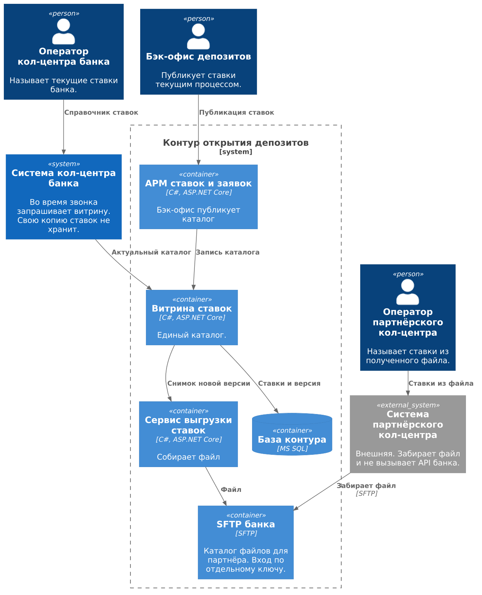
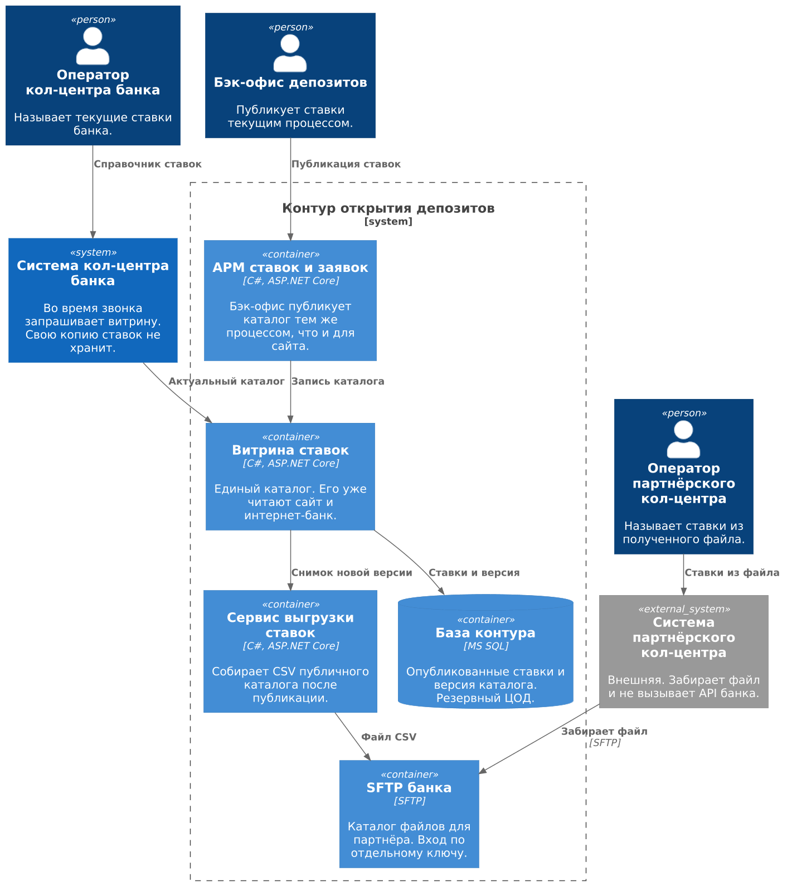

### **Название задачи:** Доступ кол-центров партнёров к ставкам депозитов
### **Автор:** Лушников А.М.
### **Дата:** 14.10.2026

### **Функциональные требования**
|**№**|**Действующие лица или системы**|**Use Case**|**Описание**|
| :-: | :- | :- | :- |
| UC1 | Клиент, оператор, система кол-центра, витрина ставок | Проконсультировать клиента по текущим ставкам банка | 1. Клиент звонит и спрашивает условия открытия депозита. 2. Оператор открывает справочник ставок в системе кол-центра. 3. Система кол-центра запрашивает данные у витрины ставок. 4. Витрина возвращает актуальыне данные 5. Оператор называет клиенту эти условия. |
| UC2 | Бэк-офис, АРМ ставок, SFTP | Опубликовать ставки и выложить файл для партнёра | 1. Сотрудник бэк-офиса публикует ставки в АРМ 2. АРМ записывает каталог в витрину, витрина сохраняет новую версию в MS SQL. 3. После сохранения витрина передаёт снимок сервису выгрузки. 4. Сервис собирает файл. 5. Файл атомарно заменяет предыдущий на SFTP.|
| UC3 | Система партнёрского кол-центра, SFTP банка, оператор партнёра | Проверить данные по файлу ставок | 1. Система партнёра по расписанию забирает файл с SFTP банка. 2. Оператор открывает ставки из загруженного файла.|

### **Нефункциональные требования**
|**№**|**Требование**|
| :-: | :- |
| N1 | Ставки для обоих кол-центров берутся из единого места |
| N2 | Партнёру уходит только публичный каталог.|
| N3 | Партнёрская система внешняя и принимает ставки файлом по SFTP. |
| N4 | Сбой выгрузки или SFTP не откатывает публикацию ставки и не мешает кол-центру банка читать витрину. |
| N5 | Канал банка до витрины и канал файла до партнёра шифруются.|

### **Решение**

Источник ставки уже выбран в MVP: бэк-офис публикует каталог в АРМ, витрина хранит его в MS SQL, сайт и интернет-банк читают витрину. Этот ADR добавляет двух читателей того же каталога. 

Партнёрский кол-центр — другая компания и внешняя система. Сервис выгрузки в контуре, на C# и ASP.NET Core, после публикации собирает CSV и кладёт его на SFTP банка. Партнёр забирает файл своим ключом. В файл попадает тот же публичный каталог, без персональной ставки и без данных клиента.

### **Альтернативы**

**Открыть партнёру тот же HTTPS-метод витрины, что и кол-центру банка.** 

**Отправлять партнёру Excel почтой, как раньше уходили вводные для ставки.** 

### **Недостатки, ограничения, риски**

**Файл партнёра может отличаться от витрины из-за обнолвения.** 

**Партнёр хранит файл у себя.**